# stdx.compress.deflate

`stdx.compress.deflate` is raw DEFLATE ([RFC 1951](https://www.rfc-editor.org/rfc/rfc1951)): an
encoder and a decoder. [`zlib`](../zlib/README.md) and [`gzip`](../gzip/README.md) wrap its
streams in their containers.

## Use

```zig
/// Encodes `input` as one raw DEFLATE stream at level 9 into `output`, and returns the stream.
fn deflate_smallest(gpa: std.mem.Allocator, features: stdx.platform.CpuFeatures, input: []const u8, output: []u8) ![]u8 {
    const Encoder = stdx.compress.deflate.Encoder(.{ .level = 9 });
    const encoder = try gpa.create(Encoder); // about 293 KiB
    defer gpa.destroy(encoder);
    encoder.init(features);
    const len = try encoder.encode_all(input, output);
    return output[0..len];
}
```

Each example is an excerpt of [`tools/consumer/main.zig`](../../../tools/consumer/main.zig), a program
that `zig build test` builds against this tree and runs.

## What it holds

- `Decoder`: about 43 KiB, with its window of 32 KiB. It takes every stream that RFC 1951 allows.
- `Encoder(options)`: level 1, 6 or 9, and level 6 by default. Its state is about 163 KiB at level
  1, and about 293 KiB at levels 6 and 9.
- `EncoderOptions.runtime_safety`: a program may set it to false. The encoder's loops then run
  without Zig's runtime safety checks, and the assertions stay on
  ([decision 49](../../../docs/decisions.md)).
- `encoded_len_max(input_len)`: the most bytes that `encode_all` writes.
- `IoReader` and `IoWriter`: the decoder as a `std.Io.Reader`, and the encoder as a
  `std.Io.Writer`.
- `Error`: one value for each way that a stream breaks RFC 1951.

Each call follows the [streaming contract](../../codec/README.md). An encoder writes the same bytes
on every host, in every build mode, and for every split of its input.

## Performance

The chart is the latest release's: one job on each of GitHub's runners, which the `bench` workflow
runs on each release tag. A blue bar is ahead, a gray bar is level inside the noise, and an orange
bar is behind. An encoder's panel plots speed against compression ratio. A green ▲ or a red ▼ after a row's name marks a row 5% or more faster or
slower than at the previous release, where both ran on one CPU model.
[The page of the branch `charts`](https://github.com/c4milo/stdx/blob/charts/benchmarks.md) lists the counts of each panel, and
[`docs/benchmarks.md`](../../../docs/benchmarks.md#deflate-zlib-and-gzip) says how to read the chart and run the
benchmark again.


<details>
<summary>x86-64: the CPU model of the release's job</summary>



</details>
